# Personal skills

Reusable agent skills for Codex, Claude Code, OpenCode, and Pi.

Each skill lives in `skills/<name>/SKILL.md` with YAML `name` and `description` fields. Supporting scripts, references, and assets stay inside its directory. This repository is the canonical source; install individual skill directories into the discovery location supported by your agent.

See [AGENTS.md](AGENTS.md) for authoring and compatibility requirements.

Agent documentation: [Codex](https://developers.openai.com/codex/skills), [Claude Code](https://code.claude.com/docs/en/skills), [OpenCode](https://opencode.ai/docs/skills/), and [Pi](https://github.com/badlogic/pi-mono/blob/main/packages/coding-agent/docs/skills.md).

## Pstack bundle

This repository ports pstack 0.15.25 and its complete cursor-team-kit 1.2.0 companion into 81 canonical skills. Start with `poteto-mode` for engineering work, `poteto-help` for routing, and `setup-pstack` for optional per-role model configuration. See [migration scope and dependencies](docs/pstack-port.md) and [verification results](docs/pstack-verification.md). The installer also includes 38 namespaced [Matt Pocock workflows](docs/mattpocock-port.md), for 119 skills in total.

### Install skills

Python 3.9+ is required for the installer. From this checkout, choose your agent:

```sh
python scripts/install-skills.py --agent claude --project /path/to/project
python scripts/install-skills.py --agent codex --project /path/to/project
python scripts/install-skills.py --agent opencode --project /path/to/project
python scripts/install-skills.py --agent pi --project /path/to/project
```

Use `--dry-run` to preview, or `--user` instead of `--project` for a personal install. The installer copies the whole bundle, supporting resources, attribution, and source inventory. It refuses existing skill paths before copying anything. For updates, stage with `--dest /path/to/staging`, review differences, and merge deliberately. No credentials, host settings, integrations, or dependencies are installed by this command.

| Agent | Project discovery | User discovery | Invocation |
| --- | --- | --- | --- |
| Claude Code | `.claude/skills/` | `~/.claude/skills/` | `/poteto-mode` |
| Codex | `.agents/skills/` | `~/.agents/skills/` | `$poteto-mode` |
| OpenCode | `.opencode/skills/` | `~/.config/opencode/skills/` | Ask to use `poteto-mode` |
| Pi | `.pi/skills/` | `~/.pi/agent/skills/` | `/skill:poteto-mode` |

Restart or reload the host after installation. Avoid installing duplicate copies into discovery locations the same host also scans. Pi's user path above assumes its default agent directory; use `--dest` if `PI_CODING_AGENT_DIR` differs. OpenCode's user path assumes the default XDG config root; use `--dest` for a custom one. Paths were checked against current [Claude](https://code.claude.com/docs/en/skills), [Codex](https://developers.openai.com/codex/skills), [OpenCode](https://opencode.ai/docs/skills/), and [Pi](https://github.com/badlogic/pi-mono/blob/main/packages/coding-agent/docs/configuration.md) documentation.

### Native packaging

Claude Code can load this checkout as a local plugin:

```sh
claude --plugin-dir /absolute/path/to/beremaran-skills
```

Its skills use the plugin namespace, for example `/pstack:poteto-mode`. The root `.claude-plugin/plugin.json` uses the canonical `skills/` tree. Repository `CLAUDE.md` is contributor guidance; plugin behavior is carried by the skills themselves. See the [Claude plugin reference](https://code.claude.com/docs/en/plugins-reference).

Pi can install this checkout as a [local Pi package](https://github.com/badlogic/pi-mono/blob/main/packages/coding-agent/docs/packages.md):

```sh
pi install /absolute/path/to/beremaran-skills -l
```

The root `package.json` exposes only `skills/`, with no extensions or hooks. Choose either package/plugin loading or a copied skills install for each host. Codex and OpenCode use their documented skill directories here; no executable plugin is needed.

### Runtime requirements

All workflows read the shared [runtime contract](skills/pstack-runtime/SKILL.md). Models inherit the current session unless configured in `<project>/.pstack/models.md`. Delegation and integrations are optional capabilities; serial self-review is labeled and cannot satisfy independent shipping gates. History mining uses only explicitly scoped history. Native loops, cloud agents, schedulers, and Cursor APIs are replaced by capability-based workflows.

Bun is needed for `poteto-mode`'s orchestration and PR-watcher scripts. Install their locked dependencies before running them:

```sh
cd skills/poteto-mode/scripts
bun install --frozen-lockfile
bun test orch watch-pr check-plan.test.ts
bun run typecheck
```

GitHub workflows need authenticated `gh` or a supported forge integration. Browser and terminal verification reuse existing harnesses. Benny needs a separately configured and authorized runner, Slack/tracker integrations, and an app control adapter. Missing integrations remain explicit evidence gaps.

### Validate changes

Install PyYAML in your development environment, then run:

```sh
python scripts/validate-skills.py
python scripts/test-install-skills.py
claude plugin validate .
```

The port retains upstream MIT notices under [upstream/](upstream/), with the pinned commit and source file hashes in [pstack-lock.json](upstream/pstack-lock.json).

### Supervised execution and host checks

The bundle now includes a local supervisor for separate CLI workers, repeat-until tasks, detached runs, stop requests, and bounded resume. It saves state and checks the actual artifact instead of accepting an agent's success claim. It does not require a native loop command or provision cloud infrastructure. See [supervised runs](skills/pstack-runtime/references/supervised-runs.md) and [host adapters](skills/pstack-runtime/references/hosts.md) for prerequisites, permissions, and configuration.

Native inventory checks send no model prompts:

```sh
python scripts/check-host-loading.py --agent codex
python scripts/check-host-loading.py --agent opencode
python scripts/check-host-loading.py --agent pi
python scripts/check-host-loading.py --agent claude --claude-init /path/to/private/startup-transcript.jsonl
```

For repeatable behavioral testing, `python scripts/smoke-host.py prepare --agent <agent> --output /tmp/pstack-smoke-<agent>` creates an isolated TDD fixture and supervisor configuration. Preparation uses no model. Review the native host's permissions and configuration before running it; live execution uses that host's authentication and can incur model usage. Verify the artifact with `smoke-host.py verify --project <fixture-project> --transcript <native-jsonl-log>` to check behavior, preserved user files, and failing-before evidence from native tool events.

The supervisor requires Python 3.9+ on a POSIX host. Claude and Codex CLI workers can need launch from a normal terminal rather than an enclosing sandbox. Missing authentication, unsupported host capabilities, and execution limits are explicit non-passes. No permission bypass is added by the adapters.

### Upstream updates

[Track and update upstream](docs/upstream-updates.md) describes the pinned baseline, source comparison, staged three-way merges, mandatory review decisions, validation, and update receipts. `.github/workflows/upstream-check.yml` supplies a weekly read-only check and downloadable review artifacts once Actions is enabled in the published repository. It never applies or publishes updates.

```sh
python scripts/upstream.py check --checkout /path/to/cursor-plugins --fetch --ref origin/main
python scripts/upstream.py stage --checkout /path/to/cursor-plugins --ref origin/main --output /tmp/pstack-review
```

After reviewing every entry and merge candidate, use `upstream.py apply --stage /tmp/pstack-review`. It refuses stale local files and unresolved decisions, preserves intentional divergences, and rolls back validation failures. Run `python scripts/test-upstream.py` and `python -m unittest discover -s skills/pstack-runtime/scripts -p 'test_*.py'` when changing this tooling.

### Matt Pocock workflows

Also vendored: all **38** skills from [mattpocock/skills](https://github.com/mattpocock/skills), including its seven experimental workflows, pinned to upstream version 1.3.1. They use `mattpocock-*` names to preserve the existing pstack variants. Start with [mattpocock-ask-matt](skills/mattpocock-ask-matt/SKILL.md). The same installer and native packages now include **119** canonical skills.

[Coverage, adaptations, and prerequisites](docs/mattpocock-port.md) and [verification evidence](docs/mattpocock-verification.md) distinguish portable workflows from optional native integrations. Explicit-only intent and Codex policies are retained where possible; equivalent discovery filtering is not claimed for every host.

The weekly read-only upstream check covers both repositories. To inspect and take Matt Pocock updates while preserving local adaptations:

```sh
python scripts/upstream.py check --source mattpocock --checkout /path/to/mattpocock-skills --fetch
python scripts/upstream.py stage --source mattpocock --checkout /path/to/mattpocock-skills --output /tmp/mattpocock-review
# Review plan.json, resolve candidates, and record every decision and reason.
python scripts/upstream.py apply --source mattpocock --stage /tmp/mattpocock-review
```

See [upstream updates](docs/upstream-updates.md) for review gates, rollback, and receipts. pstack's existing commands continue to work without `--source`.

## Workflow diagrams

These maps cover the vendored **81-skill pstack bundle**, all **23 poteto-mode playbooks**, and all **38 Matt Pocock skills**, including the seven experimental workflows. They describe this repository's portable adaptations at the pinned versions above. Arrows show execution or a labeled handoff; dotted arrows show supporting disciplines. Capability maps show alternatives, not mandatory stages. The linked skill and playbook files remain authoritative for detailed instructions.

Diagrams are embedded as rendered SVGs so they display without a Mermaid plugin. Open an image for its full-size view; each **Mermaid source** link provides the editable diagram. Names in the Matt Pocock diagrams omit `mattpocock-` for readability. Delegation, background runs, external writes, and landing still depend on session authorization and host capabilities; self-review never substitutes for a required independent verifier.

- [Pstack routing](#pstack-entry-points-and-routing), [build](#pstack-build-repair-refactor-and-prove), [measurement](#pstack-performance-and-forensics), [design](#pstack-prototype-plan-author-and-evaluate), [PR lifecycle](#pstack-open-babysit-and-ship), [autonomy](#pstack-bounded-runs-programs-and-autopilots), and [sessions](#pstack-pause-resume-and-cleanup).
- [Matt Pocock main flow](#matt-pocock-idea-to-pr-and-retrospective), [on-ramps](#matt-pocock-triage-diagnosis-wayfinding-and-architecture), [context boundaries](#matt-pocock-context-boundary-decision-tree), [standalone tools](#matt-pocock-standalone-tools-and-supporting-disciplines), and [experimental workflows](#matt-pocock-all-seven-experimental-workflows).
- Pstack capability maps and all 24 principles follow the main workflow diagrams.

### Pstack: entry points and routing

The router selects a playbook. Read-only investigations and prototypes end with evidence or a decision; implementation playbooks continue to the PR lifecycle.

[](docs/workflows/pstack-routing.svg)

[Mermaid source](docs/workflows/pstack-routing.mmd)

### Pstack: build, repair, refactor, and prove

Each lane retains its own contract. Failed checks loop back to the owning change; all shippable lanes enter Opening a PR.

[](docs/workflows/pstack-build.svg)

[Mermaid source](docs/workflows/pstack-build.mmd)

### Pstack: performance and forensics

benchmark-checklist governs measurements. A diagnosis remains a diagnosis until a fix is requested.

[](docs/workflows/pstack-measure.svg)

[Mermaid source](docs/workflows/pstack-measure.mmd)

### Pstack: prototype, plan, author, and evaluate

These workflows produce decisions, plans, skills, or experimental evidence. A plan does not authorize its execution.

[](docs/workflows/pstack-design.svg)

[Mermaid source](docs/workflows/pstack-design.mmd)

### Pstack: open, babysit, and ship

Opening a PR starts no watcher by itself. Babysit stops at merge-ready. Shipping requires authorization and independent verification.

[](docs/workflows/pstack-pr.svg)

[Mermaid source](docs/workflows/pstack-pr.mmd)

### Pstack: bounded runs, programs, and autopilots

All modes retain operator gates and authorization limits. Serial self-review cannot satisfy an independent shipping gate.

[](docs/workflows/pstack-autonomy.svg)

[Mermaid source](docs/workflows/pstack-autonomy.mmd)

### Pstack: pause, resume, and cleanup

History is limited to the active workspace or an explicitly scoped export. Cleanup distinguishes recoverable branches from uncommitted or active work.

[](docs/workflows/pstack-session.svg)

[Mermaid source](docs/workflows/pstack-session.mmd)

### Pstack: cross-cutting investigation, delegation, and evidence

These disciplines are selected by the task’s triggers. Parallel work requires authorization and actual worker support; disclose serial fallbacks and any lost independence.

[](docs/workflows/pstack-cross-cutting.svg)

[Mermaid source](docs/workflows/pstack-cross-cutting.mmd)

### Pstack: Benny issue automation

This optional workflow requires a configured runner, authorized thread and tracker writes, and a real app control adapter. Its evidence-gated draft PR path is separate from poteto-mode’s ready-PR convention.

[](docs/workflows/pstack-benny.svg)

[Mermaid source](docs/workflows/pstack-benny.mmd)

### Matt Pocock: idea to PR and retrospective

Labels omit the common mattpocock- prefix. Keep grilling, spec, and ticket creation in one context where possible; tickets carry the durable context for fresh implementation sessions.

[](docs/workflows/matt-main.svg)

[Mermaid source](docs/workflows/matt-main.mmd)

### Matt Pocock: triage, diagnosis, wayfinding, and architecture

Generated to-tickets issues are already agent-ready and bypass triage. These entry points create or clarify work before implementation.

[](docs/workflows/matt-onramps.svg)

[Mermaid source](docs/workflows/matt-onramps.mmd)

### Matt Pocock: context boundary decision tree

The first yes wins at a phase boundary. Mid-phase, continue or delegate a scoped remainder. Missing host capabilities require the documented fallback.

[](docs/workflows/matt-context.svg)

[Mermaid source](docs/workflows/matt-context.mmd)

### Matt Pocock: standalone tools and supporting disciplines

These can be entered directly or used within the main flow. Vocabulary and writing references support other workflows rather than adding mandatory phases.

[](docs/workflows/matt-tools.svg)

[Mermaid source](docs/workflows/matt-tools.mmd)

### Matt Pocock: all seven experimental workflows

Experimental upstream workflows are included here deliberately. They are optional branches, not prerequisites of the engineering flow.

[](docs/workflows/matt-experimental.svg)

[Mermaid source](docs/workflows/matt-experimental.mmd)

### Pstack: understand and recall

Capability branches below are alternatives selected by task, not a sequence. Each node links to its full canonical workflow.

[](docs/workflows/pstack-support-1.svg)

[Mermaid source](docs/workflows/pstack-support-1.mmd)

### Pstack: review and forge helpers

Capability branches below are alternatives selected by task, not a sequence. Each node links to its full canonical workflow.

[](docs/workflows/pstack-support-2.svg)

[Mermaid source](docs/workflows/pstack-support-2.mmd)

### Pstack: ci and verification helpers

Capability branches below are alternatives selected by task, not a sequence. Each node links to its full canonical workflow.

[](docs/workflows/pstack-support-3.svg)

[Mermaid source](docs/workflows/pstack-support-3.mmd)

### Pstack: capture and improve workflows

Capability branches below are alternatives selected by task, not a sequence. Each node links to its full canonical workflow.

[](docs/workflows/pstack-support-4.svg)

[Mermaid source](docs/workflows/pstack-support-4.mmd)

### Pstack: authorized issue automation

Capability branches below are alternatives selected by task, not a sequence. Each node links to its full canonical workflow.

[](docs/workflows/pstack-support-5.svg)

[Mermaid source](docs/workflows/pstack-support-5.mmd)

### Pstack: principles 1–8

Principles are a conditional reference layer underneath all playbooks, not additional execution phases.

[](docs/workflows/pstack-principles-1.svg)

[Mermaid source](docs/workflows/pstack-principles-1.mmd)

### Pstack: principles 9–16

Principles are a conditional reference layer underneath all playbooks, not additional execution phases.

[](docs/workflows/pstack-principles-2.svg)

[Mermaid source](docs/workflows/pstack-principles-2.mmd)

### Pstack: principles 17–24

Principles are a conditional reference layer underneath all playbooks, not additional execution phases.

[](docs/workflows/pstack-principles-3.svg)

[Mermaid source](docs/workflows/pstack-principles-3.mmd)

Diagram sources: [pstack router](skills/poteto-mode/SKILL.md), [23 playbooks](skills/poteto-mode/playbooks/), [supporting skill router](skills/poteto-help/SKILL.md), [Matt Pocock router](skills/mattpocock-ask-matt/SKILL.md), [phase boundaries](skills/mattpocock-ask-matt/PHASE-BOUNDARIES.md), and the canonical `skills/*/SKILL.md` files.
