# pstack

Portable agent skills for engineering work. Pstack packages 81 skills as one canonical source tree that loads natively in Claude Code, Codex (CLI and Desktop), OpenCode, and Pi: playbooks for build, repair, diagnosis, planning, review, the PR lifecycle, and session hygiene, plus the principles and support skills they rely on.

Start with `poteto-mode` for engineering work, `poteto-help` to find the right playbook, and `setup-pstack` for optional per-role model configuration.

Each skill lives in `skills/<name>/SKILL.md` with YAML `name` and `description` fields. Supporting scripts, references, and assets stay inside its directory. See [AGENTS.md](AGENTS.md) for authoring and compatibility requirements.

## Install

The repository root is the package. Every host below loads or copies the same `skills/` tree.

### Claude Code

Add the marketplace and install the plugin in one step (Claude Code 2.1.275 or later):

```
/plugin install pstack --marketplace beremaran/pstack
```

On older versions, run the two steps separately:

```
/plugin marketplace add beremaran/pstack
/plugin install pstack@pstack
```

Plugin skills use the plugin namespace, for example `/pstack:poteto-mode`. During development, `claude --plugin-dir /path/to/pstack` loads a checkout directly. See the [plugin reference](https://code.claude.com/docs/en/plugins-reference).

### Codex

```sh
codex plugin marketplace add beremaran/pstack
codex plugin add pstack@pstack
```

Codex Desktop reads the same `pstack` marketplace.

### Pi

```sh
pi install git:github.com/beremaran/pstack
```

Add `-l` for a project-local install. Pi's [package format](https://github.com/badlogic/pi-mono/blob/main/packages/coding-agent/docs/packages.md) reads `package.json`, which exposes only `skills/` with no extensions or hooks.

### OpenCode

OpenCode V2 loads every directory named in the `skills` array of `opencode.json`. This checkout ships that config, so OpenCode finds all 81 skills while you work inside the checkout. To use pstack in another project, point your own config at the checkout:

```json
{
  "$schema": "https://opencode.ai/config.json",
  "skills": ["/path/to/pstack/skills"]
}
```

Relative paths resolve from the OpenCode working directory; `~/` and absolute paths also work. See the [OpenCode skills docs](https://opencode.ai/v2/docs/skills/).

### Any agent, via the skills CLI

```sh
npx skills add beremaran/pstack
```

The CLI detects installed agents and links the skills into their discovery directories (`--copy` to copy files instead). Use `-a` to pick agents (`claude-code`, `codex`, `opencode`, `pi`), `-s` to pick skills, and `-l` to list what the package contains before installing.

### Manual install

Every host also loads a plain directory copy. Put each `skills/<name>/` directory into the host's discovery path and restart the host:

| Agent | Project discovery | User discovery | Invocation |
| --- | --- | --- | --- |
| Claude Code | `.claude/skills/` | `~/.claude/skills/` | `/poteto-mode` |
| Codex | `.agents/skills/` | `~/.agents/skills/` | `$poteto-mode` |
| OpenCode | `.opencode/skills/` | `~/.config/opencode/skills/` | `@poteto-mode` |
| Pi | `.pi/skills/` | `~/.pi/agent/skills/` | `/skill:poteto-mode` |

Avoid installing duplicate copies into discovery locations the same host also scans. Pi's user path assumes its default agent directory; `PI_CODING_AGENT_DIR` changes it. OpenCode's user path assumes the default XDG config root.

## What's included

The port covers pstack 0.15.25 (54 skills and 23 playbooks) and its complete cursor-team-kit 1.2.0 companion, plus a shared runtime contract and packaging, for 81 skills total. Compatibility is a requirement, not a claim that every workflow was executed on every host; see [migration scope, dependencies, and provenance](docs/pstack-port.md) and the pinned source inventory in [pstack-lock.json](upstream/pstack-lock.json).

Repository manifests:

| File | Purpose |
| --- | --- |
| `plugin.json` | Agent Plugins 1.0.0 manifest: package name, version, and entry points |
| `.claude-plugin/marketplace.json` | Claude Code marketplace; the adjacent `plugin.json` is its plugin manifest |
| `.agents/plugins/marketplace.json` | Codex marketplace (Codex Desktop also reads the Claude marketplace) |
| `opencode.json` | OpenCode skill sources for this checkout |
| `package.json` | Pi package metadata (`pi.skills`) |

`scripts/validate-skills.py` checks that the manifests agree on name, version, and the root skill source.

## Runtime requirements

All workflows read the shared [runtime contract](skills/pstack-runtime/SKILL.md). Models inherit the current session unless configured in `<project>/.pstack/models.md`. Delegation and integrations are optional capabilities; serial self-review is labeled and cannot satisfy independent shipping gates. History mining uses only explicitly scoped history. Native loops, cloud agents, schedulers, and Cursor APIs are replaced by capability-based workflows.

Bun runs `poteto-mode`'s orchestration and PR-watcher scripts. Install their locked dependencies before running them:

```sh
cd skills/poteto-mode/scripts
bun install --frozen-lockfile
bun test orch watch-pr check-plan.test.ts
bun run typecheck
```

GitHub workflows need authenticated `gh` or a supported forge integration. Browser and terminal verification reuse existing harnesses. Benny needs a separately configured and authorized runner, Slack/tracker integrations, and an app control adapter. Missing integrations remain explicit evidence gaps.

## Supervised execution

The bundle includes a local supervisor for separate CLI workers, repeat-until tasks, detached runs, stop requests, and bounded resume. It saves state and checks the actual artifact instead of accepting a worker's success claim, and needs no native loop command or cloud worker. See [supervised runs](skills/pstack-runtime/references/supervised-runs.md) and [host adapters](skills/pstack-runtime/references/hosts.md) for prerequisites, permissions, and configuration.

The supervisor requires Python 3.9+ on a POSIX host. Claude and Codex CLI workers can need launch from a normal terminal rather than an enclosing sandbox. Missing authentication, unsupported host capabilities, and execution limits are explicit non-passes. The adapters add no permission bypass.

## Validate changes

Install PyYAML in your development environment, then run:

```sh
python scripts/validate-skills.py
python scripts/test-upstream.py
python -m unittest discover -s skills/pstack-runtime/scripts -p 'test_*.py'
claude plugin validate .
```

`claude plugin validate .` checks the Claude marketplace and plugin manifests, and is optional when Claude Code is not installed. `.github/workflows/validate.yml` runs these checks on pull requests and pushes to `main`.

## Upstream updates

[Track and update upstream](docs/upstream-updates.md) describes the pinned baseline, source comparison, staged three-way merges, mandatory review decisions, validation, and update receipts. `.github/workflows/upstream-check.yml` supplies a weekly read-only check and downloadable review artifacts. It never applies or publishes updates.

```sh
python scripts/upstream.py check --checkout /path/to/cursor-plugins --fetch --ref origin/main
python scripts/upstream.py stage --checkout /path/to/cursor-plugins --ref origin/main --output /tmp/pstack-review
```

After reviewing every entry and merge candidate, `upstream.py apply --stage /tmp/pstack-review` refuses stale local files and unresolved decisions, preserves intentional divergences, and rolls back validation failures.

## Workflow diagrams

These maps cover the **81-skill pstack bundle** and all **23 poteto-mode playbooks**. They describe this repository's portable adaptations at the pinned version above. Arrows show execution or a labeled handoff; dotted arrows show supporting disciplines. Capability maps show alternatives, not mandatory stages. The linked skill and playbook files remain authoritative for detailed instructions.

Diagrams are embedded as rendered SVGs so they display without a Mermaid plugin. Open an image for its full-size view; each **Mermaid source** link provides the editable diagram. Delegation, background runs, external writes, and landing still depend on session authorization and host capabilities; self-review never substitutes for a required independent verifier.

- [Pstack routing](#pstack-entry-points-and-routing), [build](#pstack-build-repair-refactor-and-prove), [measurement](#pstack-performance-and-forensics), [design](#pstack-prototype-plan-author-and-evaluate), [PR lifecycle](#pstack-open-babysit-and-ship), [autonomy](#pstack-bounded-runs-programs-and-autopilots), and [sessions](#pstack-pause-resume-and-cleanup).
- Pstack capability maps and all 24 principles follow the main workflow diagrams.

### Pstack: entry points and routing

The router selects a playbook. Read-only investigations and prototypes end with evidence or a decision; implementation playbooks continue to the PR lifecycle.

[](docs/workflows/pstack-routing.svg)

[Mermaid source](docs/workflows/pstack-routing.mmd)

### Pstack: build, repair, refactor, and prove

Each lane retains its own contract. Failed checks loop back to the owning change; all shippable lanes enter Opening a PR.

[](docs/workflows/pstack-build.svg)

[Mermaid source](docs/workflows/pstack-build.mmd)

### Pstack: performance and forensics

benchmark-checklist governs measurements. A diagnosis remains a diagnosis until a fix is requested.

[](docs/workflows/pstack-measure.svg)

[Mermaid source](docs/workflows/pstack-measure.mmd)

### Pstack: prototype, plan, author, and evaluate

These workflows produce decisions, plans, skills, or experimental evidence. A plan does not authorize its execution.

[](docs/workflows/pstack-design.svg)

[Mermaid source](docs/workflows/pstack-design.mmd)

### Pstack: open, babysit, and ship

Opening a PR starts no watcher by itself. Babysit stops at merge-ready. Shipping requires authorization and independent verification.

[](docs/workflows/pstack-pr.svg)

[Mermaid source](docs/workflows/pstack-pr.mmd)

### Pstack: bounded runs, programs, and autopilots

All modes retain operator gates and authorization limits. Serial self-review cannot satisfy an independent shipping gate.

[](docs/workflows/pstack-autonomy.svg)

[Mermaid source](docs/workflows/pstack-autonomy.mmd)

### Pstack: pause, resume, and cleanup

History is limited to the active workspace or an explicitly scoped export. Cleanup distinguishes recoverable branches from uncommitted or active work.

[](docs/workflows/pstack-session.svg)

[Mermaid source](docs/workflows/pstack-session.mmd)

### Pstack: cross-cutting investigation, delegation, and evidence

These disciplines are selected by the task’s triggers. Parallel work requires authorization and actual worker support; disclose serial fallbacks and any lost independence.

[](docs/workflows/pstack-cross-cutting.svg)

[Mermaid source](docs/workflows/pstack-cross-cutting.mmd)

### Pstack: Benny issue automation

This optional workflow requires a configured runner, authorized thread and tracker writes, and a real app control adapter. Its evidence-gated draft PR path is separate from poteto-mode’s ready-PR convention.

[](docs/workflows/pstack-benny.svg)

[Mermaid source](docs/workflows/pstack-benny.mmd)

### Pstack: understand and recall

Capability branches below are alternatives selected by task, not a sequence. Each node links to its full canonical workflow.

[](docs/workflows/pstack-support-1.svg)

[Mermaid source](docs/workflows/pstack-support-1.mmd)

### Pstack: review and forge helpers

Capability branches below are alternatives selected by task, not a sequence. Each node links to its full canonical workflow.

[](docs/workflows/pstack-support-2.svg)

[Mermaid source](docs/workflows/pstack-support-2.mmd)

### Pstack: ci and verification helpers

Capability branches below are alternatives selected by task, not a sequence. Each node links to its full canonical workflow.

[](docs/workflows/pstack-support-3.svg)

[Mermaid source](docs/workflows/pstack-support-3.mmd)

### Pstack: capture and improve workflows

Capability branches below are alternatives selected by task, not a sequence. Each node links to its full canonical workflow.

[](docs/workflows/pstack-support-4.svg)

[Mermaid source](docs/workflows/pstack-support-4.mmd)

### Pstack: authorized issue automation

Capability branches below are alternatives selected by task, not a sequence. Each node links to its full canonical workflow.

[](docs/workflows/pstack-support-5.svg)

[Mermaid source](docs/workflows/pstack-support-5.mmd)

### Pstack: principles 1–8

Principles are a conditional reference layer underneath all playbooks, not additional execution phases.

[](docs/workflows/pstack-principles-1.svg)

[Mermaid source](docs/workflows/pstack-principles-1.mmd)

### Pstack: principles 9–16

Principles are a conditional reference layer underneath all playbooks, not additional execution phases.

[](docs/workflows/pstack-principles-2.svg)

[Mermaid source](docs/workflows/pstack-principles-2.mmd)

### Pstack: principles 17–24

Principles are a conditional reference layer underneath all playbooks, not additional execution phases.

[](docs/workflows/pstack-principles-3.svg)

[Mermaid source](docs/workflows/pstack-principles-3.mmd)

Diagram sources: [pstack router](skills/poteto-mode/SKILL.md), [23 playbooks](skills/poteto-mode/playbooks/), [supporting skill router](skills/poteto-help/SKILL.md), and the canonical `skills/*/SKILL.md` files.

## License and attribution

Pstack is a maintained fork of [cursor/plugins](https://github.com/cursor/plugins) pstack 0.15.25 (MIT, Lauren Tan) and its cursor-team-kit 1.2.0 companion (MIT, Cursor), pinned at commit [101b274](https://github.com/cursor/plugins/tree/101b274dd991f694e1f7024be2157e5f3adf07de/pstack). Both notices are retained under [upstream/](upstream/). The portable adaptations and packaging in this repository are MIT licensed.
